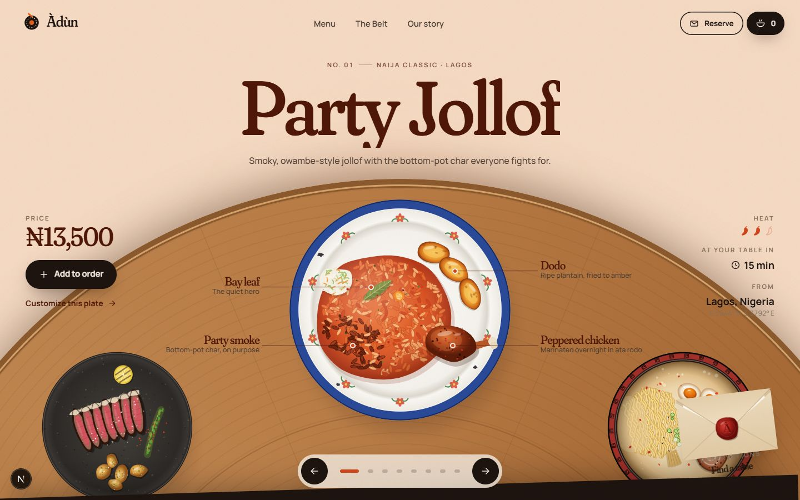
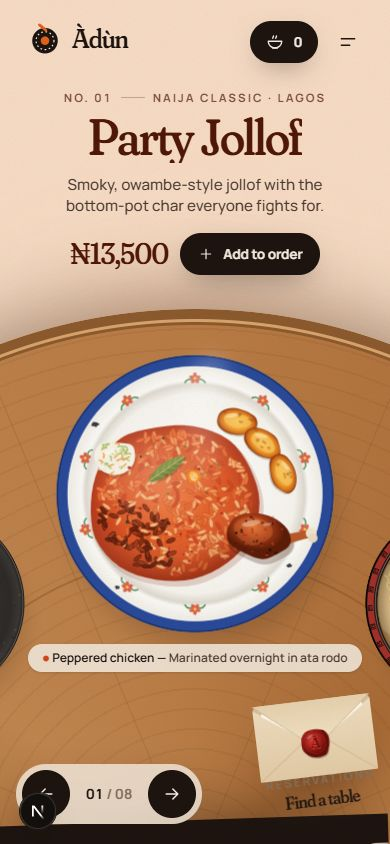
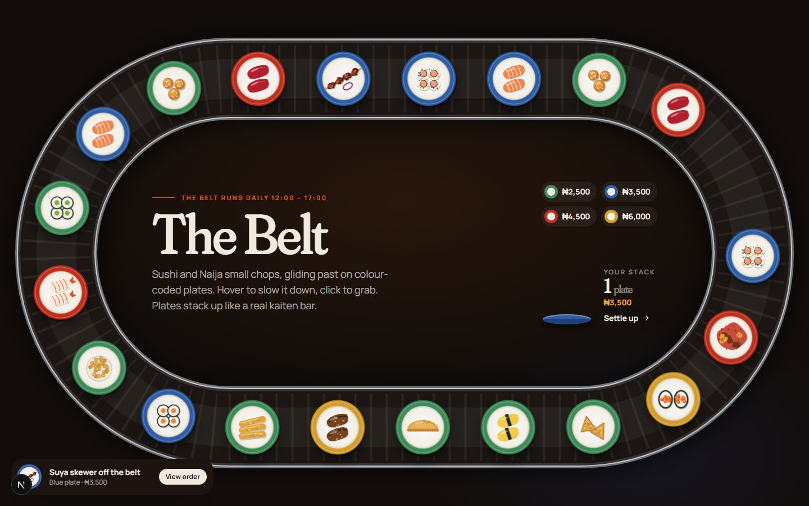
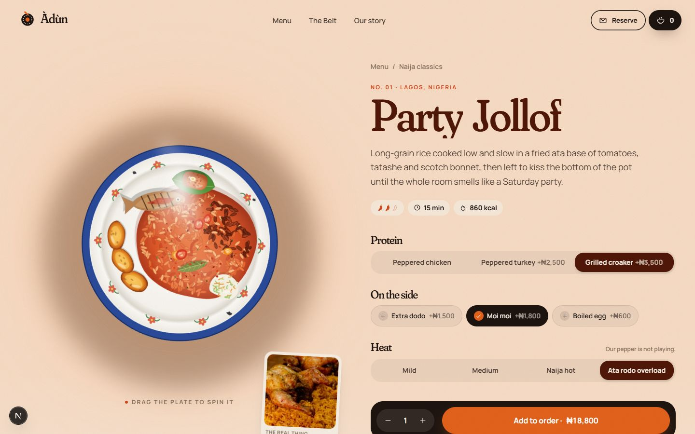
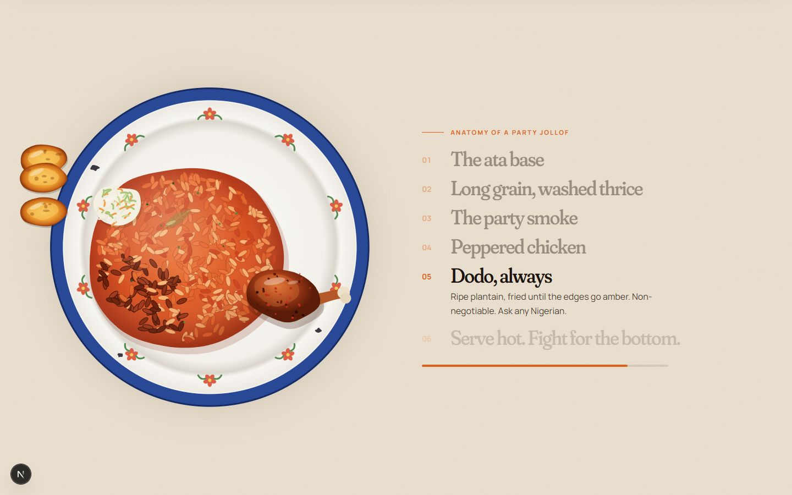
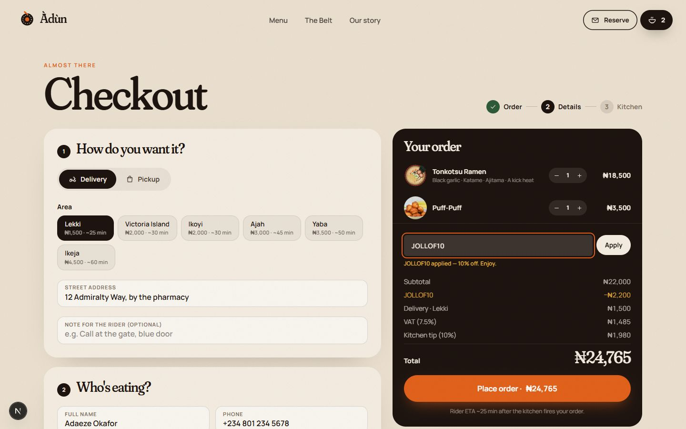
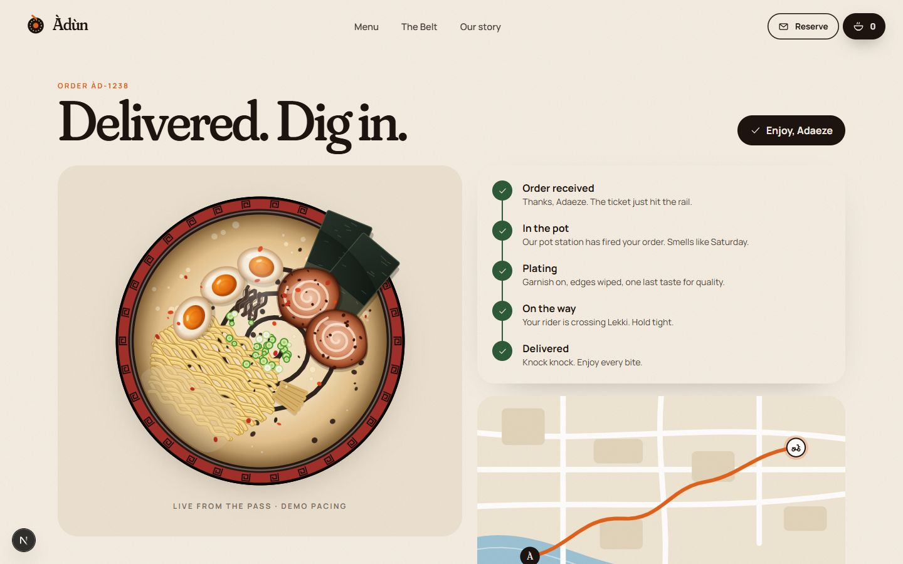
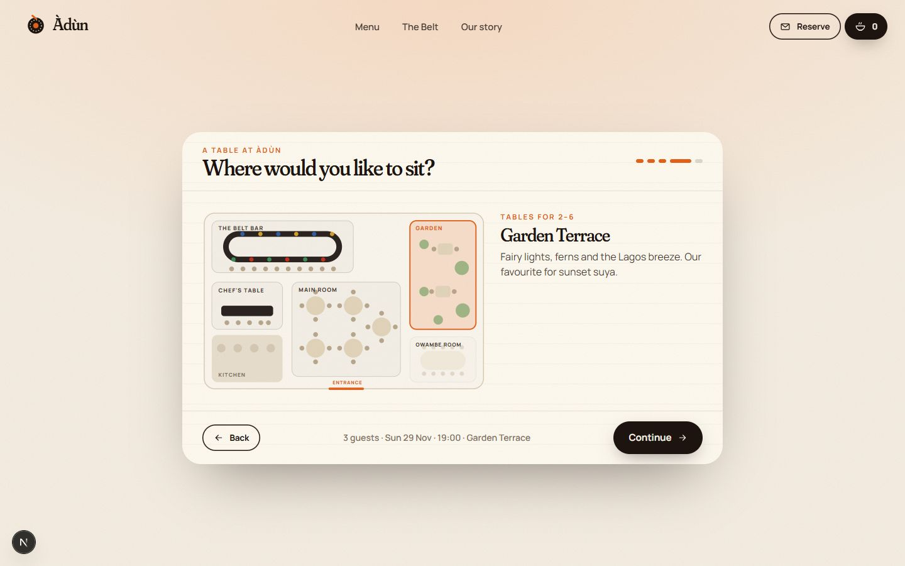
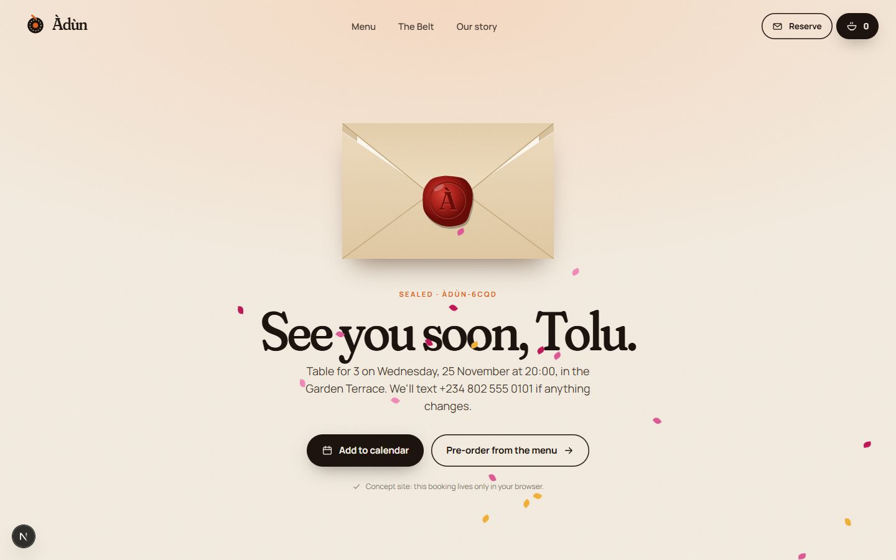

# Àdùn — Lagos-born. World-fed.

> *Àdùn* is Yoruba for **deliciousness**.

A concept restaurant website where smoky party jollof, egusi, suya and afang share one revolving table with tonkotsu, carbonara, margherita and ribeye, plus a conveyor belt of sushi and Naija small chops.

Most restaurant websites show you a menu. This one tries to make you hungry, then lets you order, track the rider and book a table without leaving the experience.



<p align="center">
  
  &nbsp;
  
</p>

---

## What's inside

| Page | What it does |
| --- | --- |
| **`/` Home** | A wooden lazy-Susan carrying eight signature plates. Drag, swipe, click a neighbour or use the arrow keys to spin it. The whole scene shifts with each dish: background colour, giant origin city, title, price and heat. Steam rises from the plate in front of you, ingredient callouts draw themselves in, and a wax-sealed envelope waits for you to find a table. |
| | Below the fold: a scroll-velocity marquee, a word-by-word story reveal, a pinned **"anatomy of a party jollof"** that builds the plate grain by grain, **The Belt** (kaiten conveyor), kitchen numbers, a horizontal food gallery, a ticket-rail of reviews and a visit section. |
| **`/menu`** | 35 dishes across Naija classics, around the world, small chops, sweets and drinks. Category and dietary filters re-flow the grid with GSAP Flip. |
| **`/menu/[slug]`** | A dish builder for each signature plate. Every option redraws the illustration: protein, swallow (pounded yam / eba / amala / semo / fufu), pasta shape, steak doneness, extras and heat. New ingredients pop onto the plate, and you can drag the plate to spin it. |
| **`/checkout`** | Delivery or pickup, six Lagos delivery zones with fees and ETAs, inline validation, kitchen tip, promo codes (`JOLLOF10`, `OWAMBE`), 7.5% VAT and a free-delivery threshold. |
| **`/order`** | Live order tracking. Your plate assembles itself stage by stage while a rider scoots across a stylised Lagos map, with confetti on delivery, a rating and one-tap reorder. |
| **`/reserve`** | The envelope breaks its own seal and the letter becomes a five-step booking: guests, date, time, an **interactive floor plan** (Belt Bar, Main Room, Garden Terrace, Chef's Table, Owambe Room) and details. Confirming slides the card back in, stamps fresh wax and lets you download an `.ics` calendar invite. |

The cart drawer, toasts, fly-to-cart animation, woven *aso-oke* page-transition curtain and first-visit preloader are shared across every page.

<p align="center">
  
  
  
  
  
  
</p>

> **No backend.** Cart, orders and reservations live in `localStorage` (Zustand + persist). Nothing typed into a form leaves the browser and no payment is taken.

---

## Tech

- **Next.js 16** (App Router, Cache Components, Partial Prerendering) on **React 19**, TypeScript
- **GSAP 3.15**: ScrollTrigger, Draggable + Inertia, Flip, MotionPath, DrawSVG, Physics2D, CustomEase, via `@gsap/react`
- **Lenis** smooth scrolling wired into ScrollTrigger
- **Zustand** for cart / order / reservation state
- **Tailwind CSS v4** with design tokens in `globals.css`
- **Fraunces** (display) + **Manrope** (UI) through `next/font`

### The food is drawn in code

Every signature plate, belt plate and topping is an SVG illustration generated from a seeded random number generator (`src/components/art`). That gives you:

- identical top-down lighting and angle on every dish, which is what makes the revolving table feel real
- deterministic output, so server and client render the same grains of rice
- ingredients as separate layers (`data-stage`, `data-layer`), which is how the plate-build scroll section, the order tracker and the dish builder animate individual pieces
- options that change the drawing, not just the price

Photography (Unsplash) is used where real food sells best: the marquee, story, gallery, menu cards and share image.

---

## Getting started

```bash
npm install
npm run dev
```

Open <http://localhost:3000>.

```bash
npm run build   # production build
npm start       # serve the build
npm run lint
```

## Project structure

```
src/
  app/                  routes: /, /menu, /menu/[slug], /checkout, /order, /reserve, /credits
                        plus opengraph-image, sitemap, robots, icon, not-found
  assets/food/          photography (Unsplash licence)
  components/
    art/                procedural SVG food engine: kit, pieces, dishes, belt plates, steam
    home/               Hero (lazy-Susan), Marquee, Manifesto, BuildAPlate, Belt, Craft, Gallery, Reviews, Visit
    menu/               MenuView (Flip filters), DishBuilder
    checkout/           Checkout, OrderTracker
    reserve/            Reserve flow, FloorPlan
    shell/              Nav, CartDrawer, Toaster, Footer, Preloader, curtain Transition, SmoothScroll
    ui/                 Envelope + WaxSeal, icons, Logo, Thumb
  lib/
    site.ts             brand, address, hours, socials, author credit  ← edit me
    menu.ts             signature dishes, options, menu items, belt plates
    store.ts            Zustand store (persisted)
    gsap.ts             plugin registration + custom eases
```

## Make it yours

1. **`src/lib/site.ts`**: set `author.name` and `author.url` (the footer credit links there), plus your socials, the brand name and the address.
2. **`src/lib/menu.ts`**: dishes, prices (₦), options and the belt line-up.
3. **`src/lib/format.ts`**: switch the currency formatter if you're not pricing in naira.

## Recording it for social

- Add `?demo` to the URL (`/?demo` or `/?demo=slow`) and the table spins by itself. You get smooth footage with no cursor jitter.
- **LinkedIn**: record at 1920×1080 or 1080×1350.
- **TikTok / Reels**: use Chrome DevTools device mode at 390×844 and record the tab. The hero is designed for 9:16.
- The preloader plays once per browser session. Open a new incognito window to capture it again.
- See [`docs/LAUNCH.md`](docs/LAUNCH.md) for a shot list and ready-to-post captions.

## Accessibility & motion

- Honours `prefers-reduced-motion`: smooth scroll, loops and big transitions switch off.
- The carousel is keyboard-operable (←/→ and named dish tabs) and announces the current dish politely.
- The belt slows to a stop when a plate has focus. Every interactive SVG zone (floor plan, plates) is a real control with a label.

## Deploy

Push to GitHub and import the repo on [Vercel](https://vercel.com/new). No environment variables are needed. Update `site.url` in `src/lib/site.ts` to your domain so the share card and sitemap use it.

## Credits

Photography by the Unsplash contributors listed on [`/credits`](src/app/credits/page.tsx), used under the [Unsplash License](https://unsplash.com/license). Illustrations, UI and code are original.

*Àdùn is a concept restaurant, not a real place (yet).*
